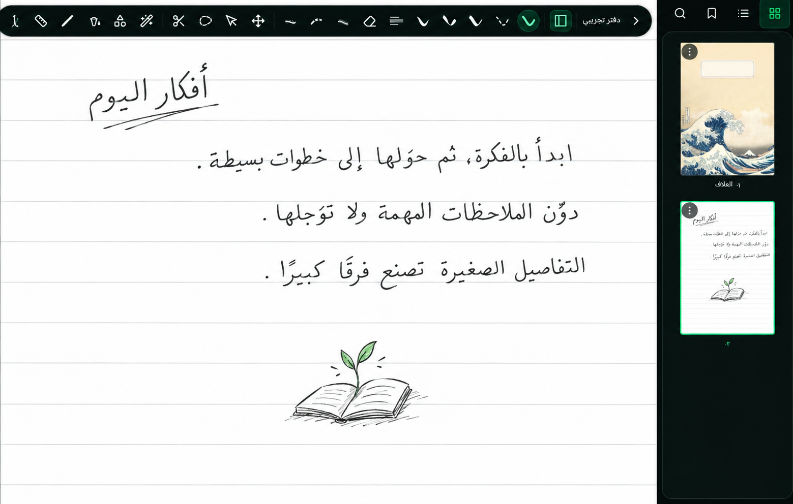
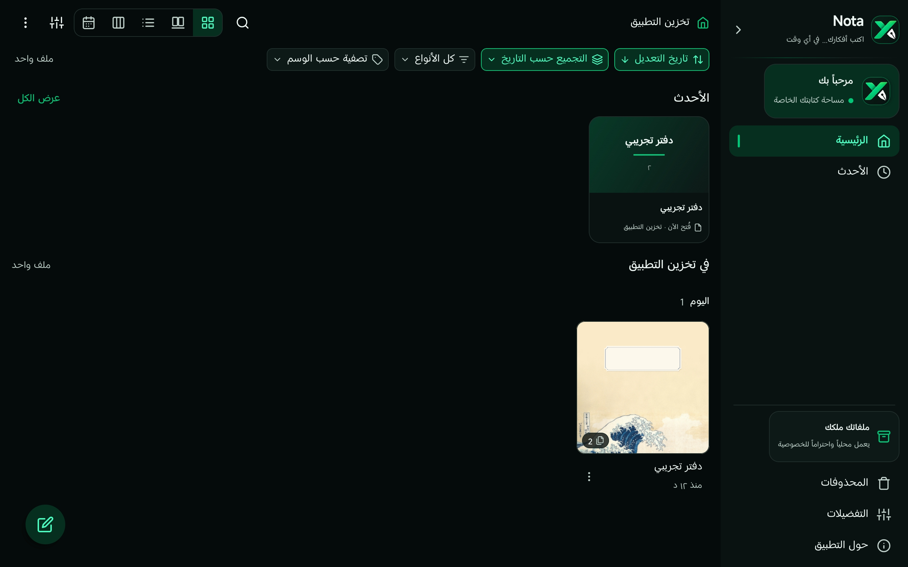
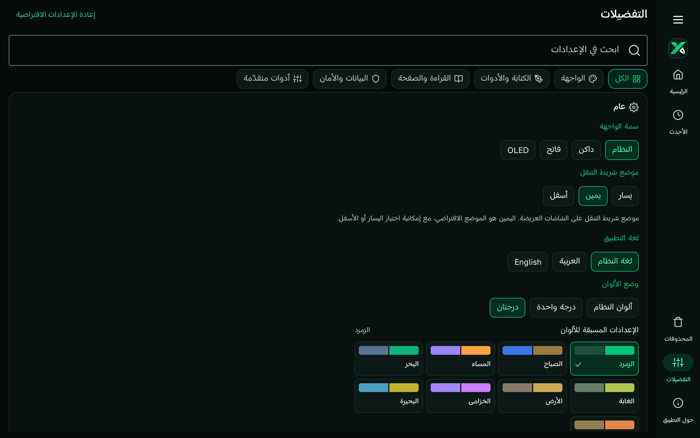
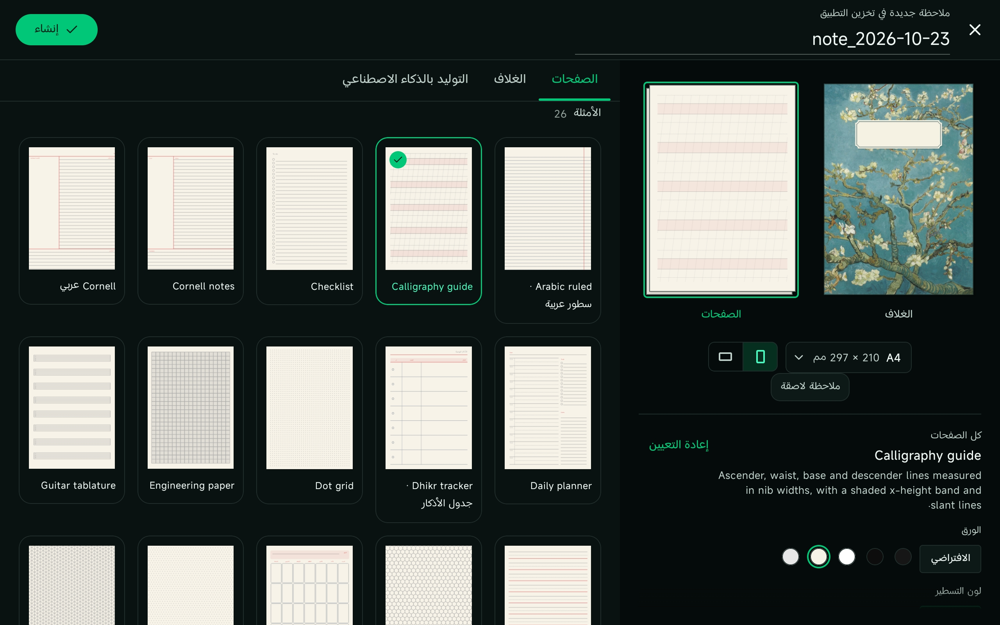
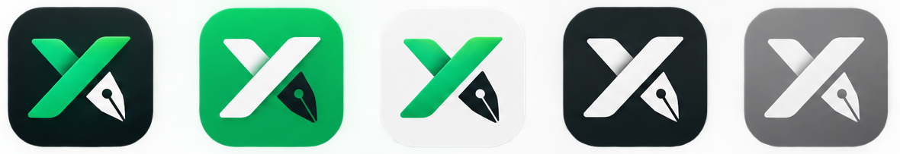
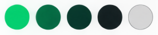

<p align="center">
  
</p>

<div dir="rtl" align="center">

**اكتب أفكارك … في مكان واحد** — دفتر ملاحظات ورسمٌ بخط اليد لأندرويد، مصمَّم **للعربية أولًا**.

</div>

<p align="center">
  <a href="https://github.com/hasan-sdaif/xnota/releases/latest"></a>
  <a href="https://github.com/hasan-sdaif/xnota/actions/workflows/build.yml"></a>
  <a href="https://github.com/hasan-sdaif/xnota/releases"></a>
  <a href="LICENSE"></a>
  <a href="https://github.com/hasan-sdaif/xnota/releases/latest"></a>
  <a href="#الاختبارات"></a>
</p>

<p align="center">
  
</p>

---

<div dir="rtl">

## ✕ إكس نوتا — XNota

**إكس نوتا** تطبيق تدوين ملاحظات ورسمٍ بخط اليد للهواتف والأجهزة اللوحية العاملة بأندرويد،
مبنيٌّ **للعربية أولاً**: من اتجاه الواجهة (RTL) إلى الخطوط إلى قوالب الصفحات.

لا حسابات، لا إعلانات، لا تتبُّع، **ولا صلاحيات إطلاقًا** — التطبيق لا يتصل بالإنترنت أصلًا.
ملاحظاتك ملفاتٌ تملكها أنت، محفوظة في مجلد تخزّنه أنت عبر إطار الوصول الآمن للملفات (SAF)،
فيعمل مع أي خدمة سحابية تختارها أو بلا سحابة على الإطلاق.

## ⬇️ التنزيل

حمِّل ملف `xnota-v1.9.1.apk` الموقَّع من [صفحة الإصدارات](https://github.com/hasan-sdaif/xnota/releases/latest)
وثبِّته مباشرة (فعِّل «التثبيت من مصادر غير معروفة» عند سؤال النظام). يتضمَّن الملف كل
المعماريات (arm64-v8a و armeabi-v7a و x86_64) ومتوافق مع أجهزة صفحات الذاكرة 16KB،
ومع كل إصدار ملف `SHA256SUMS` للتحقق من سلامة التنزيل.

| المتطلب | القيمة |
| --- | --- |
| الحد الأدنى لأندرويد | 8.0 (مستوى API 26) |
| الاستهداف | Android 16 (API 36) |
| الصلاحيات | لا شيء |
| الاتصال بالشبكة | لا شيء |

## ✨ الميزات

### عربية أولًا
- واجهة كاملة بالعربية من اليمين إلى اليسار (والإنجليزية والصينية أيضًا).
- أكثر من ١٥ عائلة خطوط عربية مدمجة في التطبيق: نسخ، كوفي، رقعة، نستعليق، وحديثة —
  من أمِري والقاهرة وريم كوفي إلى Readex Pro وIBM Plex Arabic (٣٨ عائلة خطوط إجمالًا
  تشمل اللاتينية وMonospace للكتل البرمجية).
- أرقام هندية-عربية، وخيارات التقويم الهجري.
- قوالب صفحات عربية: **كورنيل عربي**، سطور عربية، ومرشدات الخط العربي (نسخ ورقعة وخطّاط).
- الشعار والهوية والقوائم والأزرار — كلها مصمَّمة حول القراءة العربية أولًا، لا مترجمة إليها.

### محرك حبر أصلي بقلمك
- ٢٣ أداة: قلم، قلم رصاص، تظليل، نيون، قوس قزح، كاليغرافيا، قلم السرعة، خطوط متقطعة،
  تدرُّج، ممحاة، نص، صندوق نص، أشكال، تعبئة، مسطرة، لاسو، تحديد، صورة، ترميز، قياس، لقطة…
- استجابة ضغط القلم مع منحنيات معايرة مستقلة لكل أداة (جاما، منطقة ميتة، تنعيم).
- تظليل الميلان، ورسم التحويم (hover) على الأجهزة الداعمة.
- أزرار القلم الثانوية قابلة للبرمجة: Xiaomi Smart Pen و S-Pen وأقلام USI —
  زر أثناء الضغط، زر بالنقر، نقر مزدوج على جسم القلم.
- الحبر التكيُّفي: الألوان المحفوظة تُعيد نغمتها فوق الورقة (حبر أبيض على صفحة داكنة
  يُقرأ أسودَ على صفحة فاتحة) دون أن يتغيَّر اللون المُحفَظ نفسه أبدًا.

### إيماءات الجهاز اللوحي
- إصبعان بنقرة = تراجع، ثلاثة أصابع = إعادة — وكلاهما قابل للتخصيص.
- التقاط الأشكال (shape snapping)، لاسو التحديد، والعرض المقسَّم.
- شريط أدوات يمين/وسط/يسار حسب راحة يدك، وتصميم يتكيَّف مع الهاتف والجهاز اللوحي.

### دفاتر وصفحات
- دفاتر مُقسَّمة إلى صفحات، ولوحة لا نهائية (infinite canvas) في آنٍ واحد.
- ٢٦ قالب صفحة جاهزًا: سطور، شبكة نقاط، شبكة هندسية، كورنيل، قوائم، نوتة موسيقية،
  إيزومتري، ومرشدات الخط…
- أغلفة دفاتر وسمات وورق يتبع مظهر النظام (فاتح/داكن/OLED).
- استيراد ملفات PDF وشرحها وتصديرها عبر محرك PDFium، مع إشارات مرجعية تلقائية للعناوين.
- للمبرمجين: كتل كود بتلوين صناعي (tree-sitter)، وصيغ رياضية (LaTeX).

### خصوصية بلا مساومة
- **صفر صلاحيات** في بيان التطبيق — تحقَّق بنفسك من الشيفرة.
- لا اتصال شبكي في التطبيق إطلاقًا؛ لا حسابات، لا إعلانات، لا قياس عن بُعد.
- قفل التطبيق برمز PIN (مع خيار مهلة القفل).
- نسخ احتياطي واستعادة، وذاكرة تخزين مؤقت تحت سيطرتك الكاملة من التفضيلات.

## 📸 لقطات الشاشة

<p align="center">
  
</p>
<p align="center"><sub>الشاشة الرئيسية — الرفوف والتصنيفات، بطاقات الدفاتر، وزر الإنشاء.</sub></p>

<p align="center">
  
  
</p>
<p align="center"><sub>التفضيلات (البحث والتصنيفات والسمات) — وقوالب الصفحات الجاهزة.</sub></p>

## 🎨 هوية العلامة

علامة X قلمِ حبرٍ مكتوبة بحرف واحد: الحرف والريشة شيء واحد، والعلامة تكتمل بكلمة «Nota».
خمسة تنويعات للأيقونة، وثلاث صيغ للتوقيع (lockup)، ولوحة ألوان من خمسة ألوان:

<p align="center">
  
</p>
<p align="center"><sub>تنويعات أيقونة التطبيق على خلفياتها الخمس.</sub></p>

<p align="center">
  
</p>
<p align="center"><sub>لوحة ألوان العلامة: الأخضر، الأخضر الداكن، أخضر الغابة، الحبر، والرمادي الفاتح.</sub></p>

اللوحة الكاملة للهوية موجودة في [`docs/brand/identity-board.png`](docs/brand/identity-board.png)،
وتوثيق نظام العلامة الأصلي داخل التطبيق في [`docs/fork/native-brand-system.md`](docs/fork/native-brand-system.md).

## 🛠️ البناء من المصدر

المتطلبات: JDK 17، Android SDK 36 (CompileSdk)، NDK 27.0.12077973، CMake 3.22.1.

```bash
./gradlew assembleRelease
```

التوقيع يقرأ ملف `keystore.properties` المتجاهَل في git (انظر `keystore.properties.example`).
يبني GitHub Actions إصدارات موقَّعة من أسرار المستودع عند كل وسم `v*` — انظر
[سجلّ الإصدارات](https://github.com/hasan-sdaif/xnota/releases).

## 🧪 الاختبارات

٢٤٣٤ اختبارًا آليًا (وحدات + تكامل JVM) تُبنى وتجري في كل دفعة إلى `main`، إضافة إلى
جولة لقطات شاشة على محاكي عربي RTL للتدقيق البصري قبل كل إصدار — كلا سيرَي العمل أخضران.

## 🗂️ بنية المشروع

```
app/src/main/java/com/xnota/
├── core    # المحرك: الحبر، النماذج، الأنماط
├── canvas  # لوحة الرسم والتفاعل
├── gl      # طبقة OpenGL
├── format  # صيغ الملفات والاستيراد/التصدير
├── ui      # الواجهات والهوية والقوائم
├── settings# التفضيلات وإعدادات القفل
├── platform# تكاملات النظام
└── vendor  # المكتبات المدمجة
```

## 📄 الوثائق

- [نظام العلامة الأصلي](docs/fork/native-brand-system.md) — كيف تُبنى الهوية داخل
  الواجهة بـ Kotlin و Compose، لا كصور ثابتة.
- [ملاحظات إصدار 1.9.1](docs/fork/release-notes/v1.9.1.md).

## 👨‍💻 المطوّر

**Hasan Sdaif** — [@hasan-sdaif](https://github.com/hasan-sdaif)

حسابك للدعم والمتابعة على GitHub هو المكان الأول للأخبار والإصدارات.

## 📜 الرخصة

رخصة MIT — انظر [LICENSE](LICENSE). الخطوط المدمجة برخصة SIL OFL
(يسردها التطبيق كاملةً في شاشة الرخص داخل التطبيق).

</div>

---

## ✕ XNota (English)

**XNota** is a handwriting notes and sketching app for Android phones and tablets,
built **Arabic-first** — from the RTL interface to the fonts to the page templates.

No accounts, no ads, no tracking, and **zero permissions** — the app never touches
the network. Your notes are files you own, stored in a folder you pick through the
Storage Access Framework (SAF), so they work with any cloud — or none at all.

## ⬇️ Download

Grab the signed `xnota-v1.9.1.apk` from the
[latest release](https://github.com/hasan-sdaif/xnota/releases/latest) and install it
directly (enable “install from unknown sources” if asked). The APK is multi-ABI
(arm64-v8a, armeabi-v7a, x86_64), 16 KB memory-page compatible, and every release
ships a `SHA256SUMS` file so you can verify the download.

| Requirement | Value |
| --- | --- |
| Minimum Android | 8.0 (API 26) |
| Target | Android 16 (API 36) |
| Permissions | None |
| Network access | None |

## ✨ Features

### Arabic-first
- A fully RTL Arabic interface (English and Chinese too).
- 15+ bundled Arabic font families — Naskh, Kufi, Ruqaa, Nastaliq and modern faces
  from Amiri, Cairo and Reem Kufi to Readex Pro and IBM Plex Arabic (38 families
  in total, including Latin and monospace for code).
- Arabic-Indic digits and Hijri calendar options.
- Arabic page templates: **Cornell عربي**, Arabic ruled, and Arabic calligraphy
  guides (Naskh, Ruqaa, Khatt).
- The brand, the menus, the buttons — designed around Arabic reading first, not
  translated into it.

### A native ink engine for your stylus
- 23 tools: pen, pencil, highlighter, neon, rainbow, calligraphy, speed pen, dashed,
  taper, eraser, text, text box, shapes, fill, ruler, lasso, select, image, markup,
  measure, screenshot…
- Pressure response with per-tool calibrated curves (gamma, dead zone, smoothing).
- Tilt shading and hover tools on supported hardware.
- Programmable pen buttons — Xiaomi Smart Pen, S-Pen, USI: button-while-drawing,
  button-tap, double-tap on the barrel.
- Adaptive ink: stored colours re-tone themselves to the paper (white ink on a dark
  page reads black on a light page) while the saved colour never changes.

### Tablet gestures
- Two-finger tap = undo, three-finger tap = redo — both remappable.
- Shape snapping, lasso selection, split view.
- A toolbar that sits left, centre or right wherever your hand rests, with layouts
  that adapt from phone to tablet.

### Notebooks and pages
- Paged notebooks and an infinite canvas in one app.
- 26 ready page templates: lined, dot grid, engineering grid, Cornell, checklists,
  music staff, isometric, calligraphy guides…
- Notebook covers, themes, and paper that follows the system look
  (light/dark/OLED).
- PDF import, annotation and export via the PDFium engine, with automatic heading
  bookmarks.
- For developers: syntax-highlighted code blocks (tree-sitter) and LaTeX.

### Privacy without compromise
- **Zero permissions** in the manifest — verify it yourself in the code.
- No network access at all; no accounts, no ads, no telemetry.
- PIN app lock (with a delay option).
- Backup and restore, and a cache you fully control from Preferences.

## 📸 Screenshots

<p align="center">
  
</p>
<p align="center"><sub>The home screen — shelves and categories, notebook cards, and the create button.</sub></p>

<p align="center">
  
  
</p>
<p align="center"><sub>Preferences (search, categories, themes) — and the ready page templates.</sub></p>

## 🎨 Brand identity

An X written as one ink-pen stroke: the letter and the nib are a single mark,
completed by the word “Nota”. Five icon variations, three lockups, and a
five-colour palette:

<p align="center">
  
</p>
<p align="center"><sub>The app icon in its five tile variations.</sub></p>

<p align="center">
  
</p>
<p align="center"><sub>The brand palette: green, dark green, forest, ink, and light grey.</sub></p>

The full identity board lives in [`docs/brand/identity-board.png`](docs/brand/identity-board.png),
and the native in-app brand system is documented in
[`docs/fork/native-brand-system.md`](docs/fork/native-brand-system.md).

## 🛠️ Building from source

Requirements: JDK 17, Android SDK 36 (compileSdk), NDK 27.0.12077973, CMake 3.22.1.

```bash
./gradlew assembleRelease
```

Signing reads a gitignored `keystore.properties` (see `keystore.properties.example`).
GitHub Actions builds signed releases from repository secrets on every `v*` tag —
see the [releases page](https://github.com/hasan-sdaif/xnota/releases).

## 🧪 Testing

2,434 automated tests (JVM unit + integration) build and run on every push to
`main`, plus a screenshots walkthrough on an Arabic-RTL emulator for visual review
before each release — both workflows green.

## 🗂️ Project structure

```
app/src/main/java/com/xnota/
├── core    # the engine: ink, models, patterns
├── canvas  # the drawing canvas and interaction
├── gl      # the OpenGL layer
├── format  # file formats and import/export
├── ui      # panes, brand, navigation
├── settings# preferences and app lock
├── platform# system integrations
└── vendor  # vendored libraries
```

## 📄 Documentation

- [Native brand system](docs/fork/native-brand-system.md) — how the identity is
  built inside the UI with Kotlin and Compose, not as static art.
- [Release notes 1.9.1](docs/fork/release-notes/v1.9.1.md).

## 👨‍💻 Developer

**Hasan Sdaif** — [@hasan-sdaif](https://github.com/hasan-sdaif)

## 📜 License

MIT — see [LICENSE](LICENSE). Bundled fonts are SIL OFL (the in-app license screen
lists every family).
